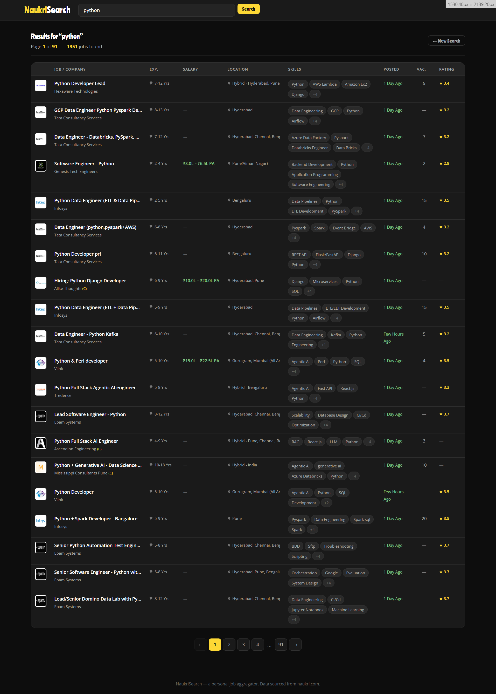
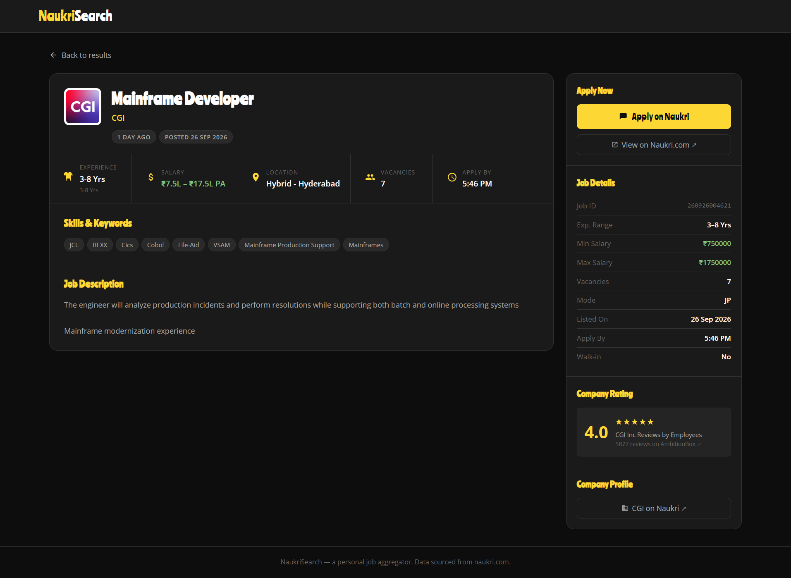

# NaukriSearch

A personal job-search web application built with Django that fetches live listings from **Naukri.com** and displays richer details than the standard Naukri interface — including full job descriptions, salary breakdowns, vacancy counts, AmbitionBox ratings, and CSV export.

---

## Screenshots

> **Search Results**
>
> 

> **Job Detail page**
>
> 

---

## Tech Stack

| Layer | Technology |
|---|---|
| Backend | Python 3.13 · Django 6.1 |
| Browser automation | Playwright 1.49 (real Chrome channel) |
| HTTP client | requests 2.34 |
| Environment config | python-dotenv 1.2 |
| Frontend | Vanilla HTML/CSS (no framework) — dark theme |
| Fonts | Google Fonts — Ranchers (headings) · Open Sans (body) |
| Database | SQLite (Django default — not actively used) |
| Data source | Naukri.com private job search API (v3) |

---

## Features

- 🔍 **Keyword search** — search any job title, skill, or role
- 📋 **Rich results table** — title, company logo, experience, salary, location, skills, posted date, vacancies, AmbitionBox rating
- 📄 **Job detail page** — full job description (HTML rendered), all metadata, direct Apply on Naukri button
- 📥 **CSV export** — download current page results as a spreadsheet (21 columns)
- 📑 **Pagination** — 20 results per page with smart page-range navigation
- 🤖 **Auto fresh credentials** — Playwright launches real Chrome headlessly to capture a fresh `nkparam` on every search — no manual token updates needed
- 🌙 **Dark theme** — styled after a premium dark UI (`#0d0d0d` background, `#fdd835` accent)

---

## Project Structure

```
jobsearch/                        ← Django project root
├── .env                          ← credentials (git-ignored)
├── .env.example                  ← template for .env
├── .gitignore
├── README.md
├── manage.py
│
├── jobsearch/                    ← Django project settings package
│   ├── settings.py               ← loads .env, registers naukri app
│   ├── urls.py                   ← root URL config
│   ├── wsgi.py
│   └── asgi.py
│
├── naukri/                       ← main Django app
│   ├── naukri_client.py          ← Playwright header capture + API calls
│   ├── views.py                  ← index, job_detail, export_csv views
│   ├── forms.py                  ← SearchForm
│   ├── urls.py                   ← app URL patterns
│   ├── models.py                 ← (empty — no DB models needed)
│   └── templatetags/
│       └── naukri_extras.py      ← |safe_json custom filter
│
├── templates/naukri/
│   ├── base.html                 ← dark theme CSS + header/footer layout
│   ├── index.html                ← hero + search form + results table
│   └── job_detail.html           ← 2-column detail page
│
└── static/                       ← static files directory (currently empty)
```

---

## Prerequisites

Before you start, make sure you have:

- **Python 3.10+** installed — check with `python --version`
- **Google Chrome** installed (required by Playwright for bot-detection bypass)
- **Git** installed

---

## Setup — Step by Step

### 1. Clone the repository

```bash
git clone https://github.com/your-username/naukrisearch.git
cd naukrisearch/jobsearch
```

### 2. Create and activate a virtual environment

**Windows:**
```bash
python -m venv venv
venv\Scripts\activate
```

**macOS / Linux:**
```bash
python -m venv venv
source venv/bin/activate
```

You should see `(venv)` in your terminal prompt.

### 3. Install Python dependencies

```bash
pip install -r requirements.txt
```

If `requirements.txt` doesn't exist yet, install manually:

```bash
pip install django==6.1.1 requests==2.34.2 python-dotenv==1.2.3 playwright==1.49.0
```

### 4. Install the Playwright Chrome browser

This is a **one-time download** (~120 MB). Playwright uses your real Chrome for bot-detection bypass:

```bash
playwright install chrome
```

> ⚠️ Do NOT run `playwright install chromium` — headless Chromium gets blocked by Naukri. You need `chrome`.

### 5. Set up environment variables

```bash
# Windows
copy .env.example .env

# macOS / Linux
cp .env.example .env
```

Open `.env` and fill in your `NAUKRI_NKPARAM` value (see below).

### 6. Get your NAUKRI_NKPARAM

The app uses Playwright to auto-refresh `nkparam` on every search, but you need a valid starting value:

1. Open **Chrome** and go to [naukri.com](https://www.naukri.com)
2. Search for any keyword (e.g. `python`)
3. Open **DevTools** → `F12`
4. Go to the **Network** tab
5. Find a request to `jobapi/v3/search`
6. Click it → **Headers** → **Request Headers**
7. Copy the value of `nkparam`
8. Paste it into your `.env` file:

```
NAUKRI_NKPARAM=your_copied_value_here
```

> 💡 Even if this value expires, the app will auto-refresh it via Playwright. Having any recent valid value here helps the first request succeed immediately.

### 7. Apply Django migrations

```bash
python manage.py migrate
```

### 8. Run the development server

```bash
python manage.py runserver
```

Open your browser and go to: **http://127.0.0.1:8000**

---

## Usage

### Searching for jobs

1. On the home page, type a keyword (e.g. `python`, `django`, `react`, `data scientist`)
2. Click **Search** or press Enter
3. Results appear in a table — each row shows:
   - Company logo
   - Job title + company name
   - Experience required
   - Salary (or "Not disclosed")
   - Location
   - Top skills
   - Posted date
   - Vacancy count
   - AmbitionBox employee rating

### Viewing job details

- Click any row in the results table to open the full job detail page
- The detail page shows:
  - Full HTML job description
  - All metadata (experience range, exact salary, vacancy count, apply-by time, posted date, job ID)
  - AmbitionBox rating widget (links to reviews)
  - Company profile link on Naukri
  - **Apply on Naukri** button

### Navigating pages

- Use the **← →** pagination controls at the bottom of results
- Each page shows 20 jobs

### Downloading results as CSV

- Click the **↓ CSV** button in the results header to download the current page
- The CSV file includes 21 columns: title, company, experience, salary, location, skills, vacancies, posted date, min/max experience, salary details, today/walk-in flags, apply-by time, listed date, AmbitionBox rating, job ID, and Naukri apply URL
- Filename format: `naukri_<keyword>_p<page>.csv`

### Returning to search

- Click **← New Search** or the **NaukriSearch** logo in the header

---

## How the API Works

Naukri uses a rotating `nkparam` HMAC signature that changes with every browser session. Standard `requests` calls always get blocked because `nkparam` expires.

**This app solves it by:**

1. On each search, Playwright launches a **real headless Chrome** (not Chromium)
2. Chrome navigates to the Naukri search results page for your keyword
3. We intercept the `jobapi/v3/search` XHR using `page.route()`
4. All request headers — including the freshly generated `nkparam` — are captured
5. Those exact headers are then used with `requests.get()` for all page fetches in that session

This means `nkparam` is always valid because it comes from a real browser session.

> **Note:** Each search takes ~5–8 seconds extra for the browser launch. This is expected behavior.

---

## Generating requirements.txt

If you want to freeze your exact dependency versions:

```bash
pip freeze > requirements.txt
```

---

## Common Issues

| Problem | Solution |
|---|---|
| `Could not capture API headers` | Make sure Chrome is installed and run `playwright install chrome` |
| `Unexpected error: Expecting value` | Your `nkparam` in `.env` may be stale — the app will auto-refresh it, just retry |
| `API error 406` | Headers mismatch — restart the server and try again |
| `API error 401` | Session expired — get a fresh `nkparam` from DevTools and update `.env` |
| Blank job detail page | Ensure you are clicking a row, not a link inside it |
| Slow searches (~8s) | Normal — Playwright browser launch takes a few seconds on first search |

---

## Disclaimer

This project is for **personal/educational use only**. It accesses Naukri.com's internal API. Use responsibly and review Naukri's terms of service before any extended use.

---

## License

MIT — do whatever you want, just don't blame me if it breaks. 😄
